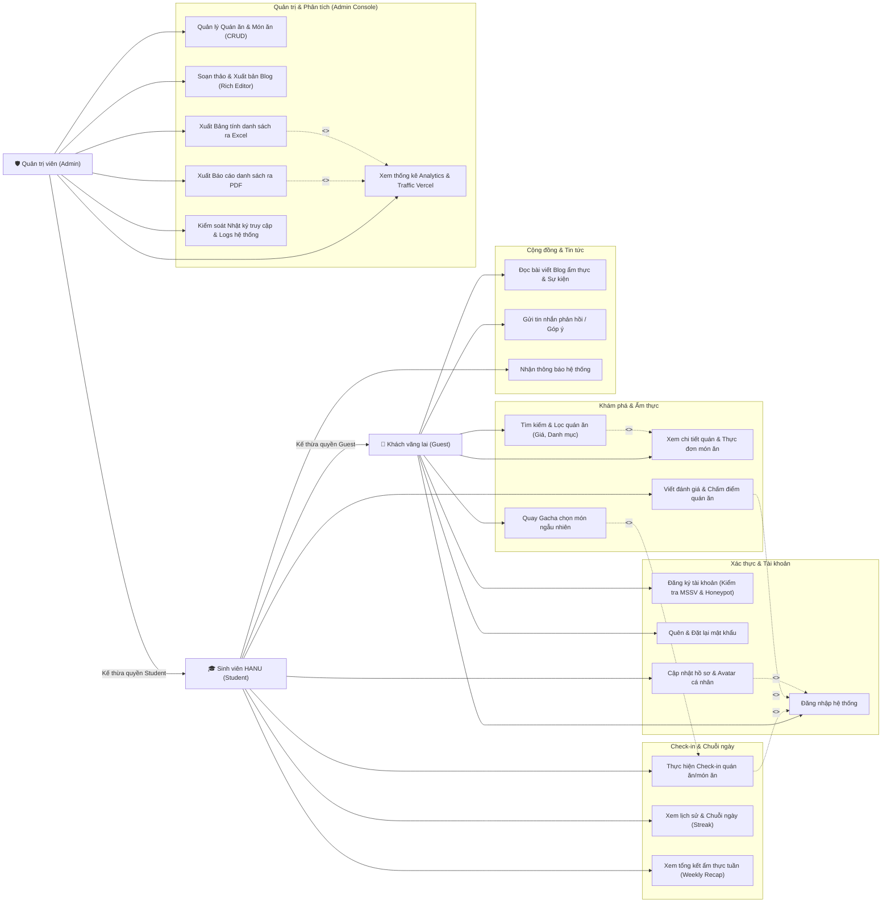
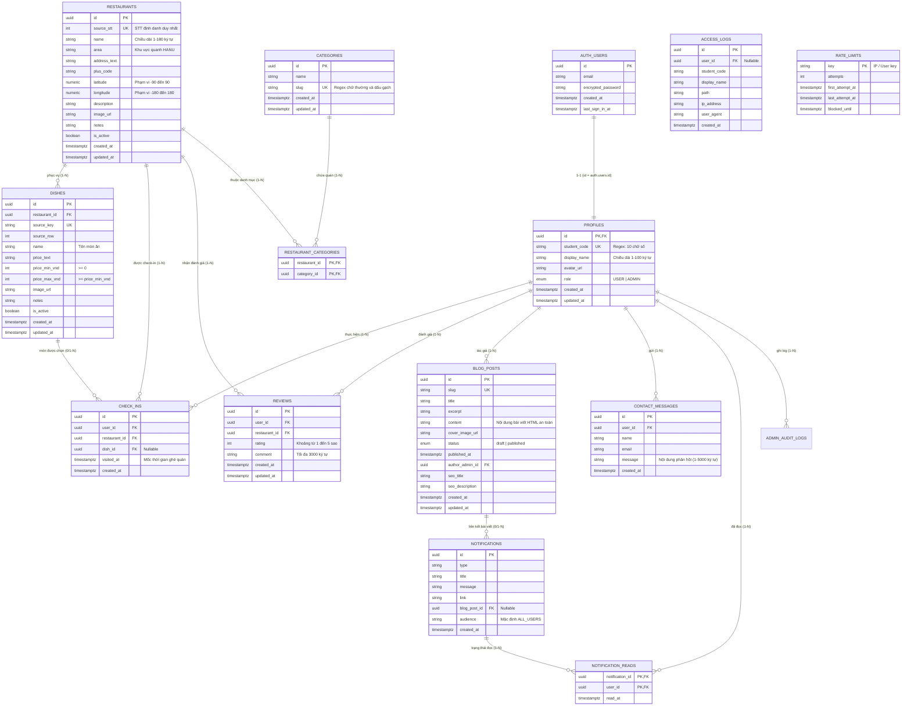
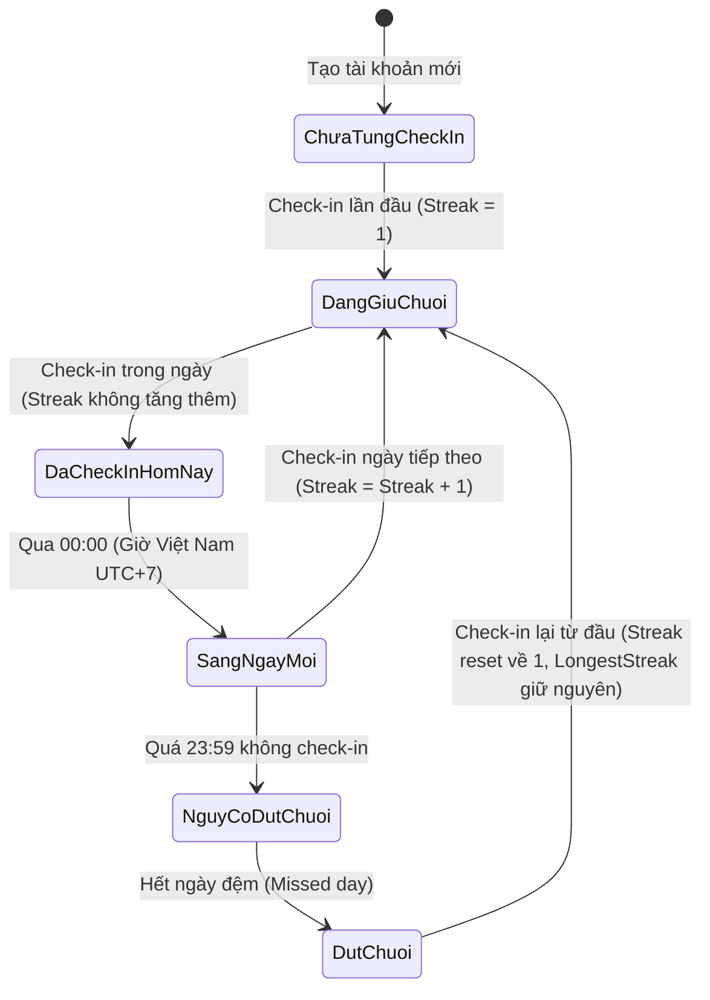
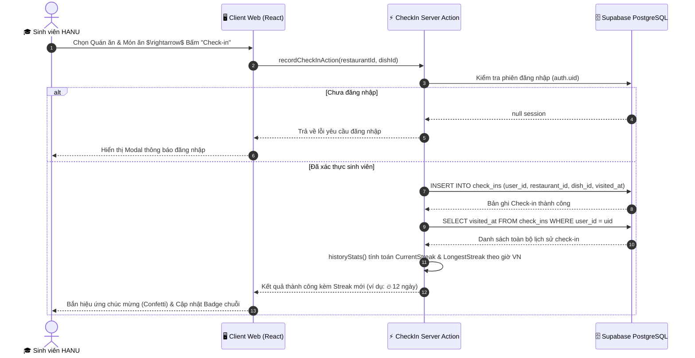
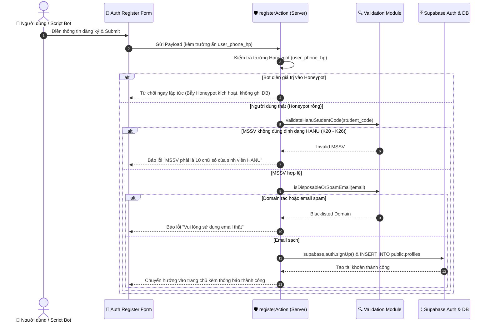
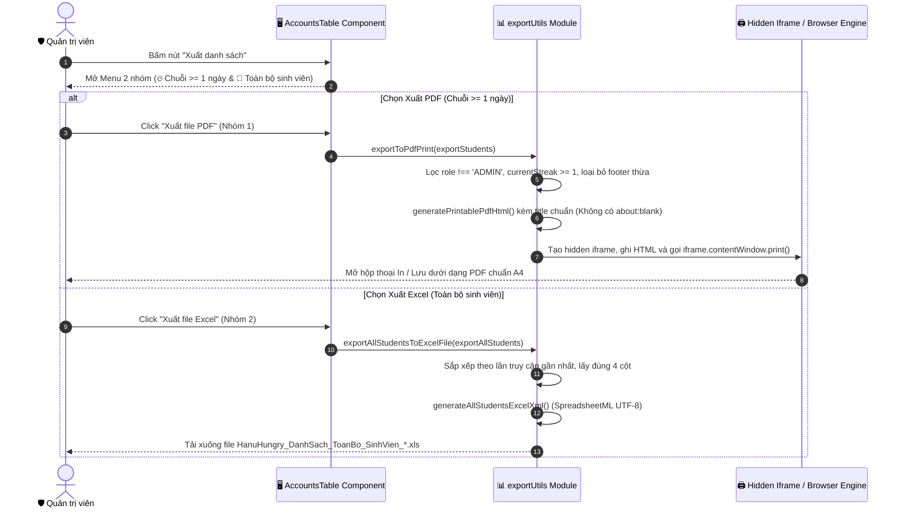

# TÀI LIỆU ĐẶC TẢ KIẾN TRÚC & THIẾT KẾ HỆ THỐNG HANU HUNGRY

> **Dự án**: Hanu Hungry - Nền tảng Khám phá Ẩm thực & Thống kê Check-in Sinh viên HANU  
> **Phiên bản tài liệu**: 2.0 (Cập nhật ngày 05/11/2026)  
> **Công nghệ nền tảng**: Next.js 15 (App Router), TypeScript, Tailwind CSS, Supabase (PostgreSQL, Auth, Storage, RLS), Vercel Web Analytics.

---

## MỤC LỤC
1. [TỔNG QUAN HỆ THỐNG](#1-tổng-quan-hệ-thống)
2. [SƠ ĐỒ USE CASE (USE CASE DIAGRAM)](#2-sơ-đồ-use-case-use-case-diagram)
   - 2.1. Phân loại tác nhân (Actors)
   - 2.2. Biểu đồ Use Case tổng thể
   - 2.3. Danh mục Use Case chi tiết theo phân hệ
3. [SƠ ĐỒ THỰC THỂ QUAN HỆ (ENTITY-RELATIONSHIP DIAGRAM - ERD)](#3-sơ-đồ-thực-thể-quan-hệ-entity-relationship-diagram---erd)
   - 3.1. Biểu đồ ERD chuẩn Mermaid
   - 3.2. Đặc tả từ điển dữ liệu (Data Dictionary)
   - 3.3. Ràng buộc toàn vẹn & Cơ chế bảo mật Row-Level Security (RLS)
4. [SƠ ĐỒ LỚP (CLASS DIAGRAM - PHÂN TẦNG CLEAN ARCHITECTURE)](#4-sơ-đồ-lớp-class-diagram---phân-tầng-clean-architecture)
   - 4.1. Kiến trúc phân tầng ứng dụng
   - 4.2. Biểu đồ Class Diagram chi tiết
   - 4.3. Mô tả các tầng: Domain Entities, Server Actions/Services, UI & Hooks
5. [ĐẶC TẢ WIREFRAME (BỐ CỤC GIAO DIỆN RESPONSIVE)](#5-đặc-tả-wireframe-bố-cục-giao-diện-responsive)
   - 5.1. Màn hình 1: Trang chủ & Khám phá quán ăn (Home & Search)
   - 5.2. Màn hình 2: Trang Chi tiết quán ăn & Thực đơn / Đánh giá
   - 5.3. Màn hình 3: Vòng quay Gacha ngẫu nhiên ("Hôm nay ăn gì?")
   - 5.4. Màn hình 4: Lịch sử Check-in & Chuỗi ngày (Streak Dashboard)
   - 5.5. Màn hình 5: Blog tin tức & Sự kiện ẩm thực
   - 5.6. Màn hình 6: Quản trị hệ thống (Admin Portal & Analytics)
6. [MÔ HÌNH HÓA PROTOTYPE & USER FLOW](#6-mô-hình-hóa-prototype--user-flow)
   - 6.1. State Diagram: Vòng đời chuỗi ngày Check-in (Streak Lifecycle)
   - 6.2. Sequence Diagram: Luồng Khám phá $\rightarrow$ Check-in $\rightarrow$ Cập nhật chuỗi
   - 6.3. Sequence Diagram: Luồng Đăng ký sinh viên có Honeypot chống Bot & Spam
   - 6.4. Sequence Diagram: Luồng Xuất danh sách sinh viên PDF & Excel của Admin

---

## 1. TỔNG QUAN HỆ THỐNG

Hanu Hungry là nền tảng số hóa bản đồ ẩm thực xung quanh Trường Đại học Hà Nội (HANU), giải quyết bài toán "Hôm nay ăn gì?" cho sinh viên thông qua các tính năng thông minh:
- **Khám phá ẩm thực**: Bản đồ số hóa các quán ăn, phân loại theo ngân sách, danh mục và khoảng cách đi bộ từ cổng trường HANU.
- **Vòng quay Gacha ngẫu nhiên**: Hỗ trợ sinh viên ra quyết định chọn món/quán ngẫu nhiên dựa trên mức tiền có sẵn.
- **Check-in & Gamification chuỗi ngày (Streak)**: Khuyến khích sinh viên duy trì thói quen trải nghiệm ẩm thực hàng ngày, vinh danh trên bảng xếp hạng (Leaderboard) theo múi giờ Việt Nam.
- **Bảo mật & Quản trị dữ liệu**: Cơ chế bảo vệ chống bot spam (Honeypot, chặn email rác, kiểm tra định dạng MSSV HANU K20-K26), công cụ phân tích truy cập và xuất báo cáo xếp hạng chuẩn hành chính (PDF & Excel).

---

## 2. SƠ ĐỒ USE CASE (USE CASE DIAGRAM)

### 2.1. Phân loại tác nhân (Actors)
1. **Khách vãng lai (Guest)**: Người dùng chưa đăng nhập, có thể tra cứu thông tin quán ăn, quay Gacha thử vận may, đọc bài viết blog ẩm thực, xem đánh giá của cộng đồng và gửi tin nhắn liên hệ.
2. **Sinh viên HANU (Authenticated Student - Role: USER)**: Người dùng đã đăng ký tài khoản với MSSV HANU hợp lệ, có thể thực hiện Check-in tại quán ăn để tích lũy chuỗi ngày (Streak), viết đánh giá/chấm điểm sao, nhận thông báo sự kiện, quản lý hồ sơ và đổi mật khẩu.
3. **Quản trị viên (Administrator - Role: ADMIN)**: Thành viên ban quản trị, có toàn quyền quản lý dữ liệu quán ăn, món ăn, danh mục (CRUD), phê duyệt và xuất bản blog, theo dõi thống kê phân tích Vercel Analytics, xem bảng xếp hạng chuỗi và xuất danh sách sinh viên ra file PDF/Excel.

### 2.2. Biểu đồ Use Case tổng thể



### 2.3. Danh mục Use Case chi tiết theo phân hệ

| STT | Mã Use Case | Tên Use Case | Tác nhân chính | Mô tả vắn tắt |
|:---:|:---|:---|:---|:---|
| 1 | `UC-AUTH-01` | Đăng ký sinh viên HANU | Guest | Nhập MSSV 10 chữ số (K20-K26), tên, email, mật khẩu; hệ thống kiểm tra Honeypot và chặn domain rác. |
| 2 | `UC-AUTH-02` | Đăng nhập hệ thống | Guest | Xác thực email và mật khẩu qua Supabase Auth; chuyển hướng theo vai trò (USER/ADMIN). |
| 3 | `UC-AUTH-03` | Quản lý hồ sơ & Avatar | Student | Thay đổi tên hiển thị, tải lên ảnh đại diện kiểm tra chuẩn MIME (tối đa 5MB). |
| 4 | `UC-DISC-01` | Tìm kiếm & Lọc quán ăn | Guest, Student | Tìm theo từ khóa không dấu, lọc theo khoảng giá sinh viên, danh mục ẩm thực và trạng thái mở cửa. |
| 5 | `UC-DISC-02` | Xem chi tiết & Chỉ đường | Guest, Student | Xem thông tin quán, thực đơn kèm giá min/max, bản đồ chỉ đường Google Maps / Plus Code. |
| 6 | `UC-DISC-03` | Vòng quay Gacha ngẫu nhiên | Guest, Student | Chọn ngân sách (10k - 100k) và thể loại $\rightarrow$ quay ra món ăn và quán phù hợp nhất. |
| 7 | `UC-STRK-01` | Check-in ẩm thực | Student | Ghi nhận quán và món đã ăn trong ngày; hệ thống kích hoạt tính toán chuỗi liên tiếp. |
| 8 | `UC-STRK-02` | Theo dõi chuỗi ngày (Streak) | Student | Xem chuỗi ngày hiện tại (Current Streak), chuỗi kỷ lục (Longest Streak) theo múi giờ Việt Nam (+07:00). |
| 9 | `UC-REVW-01` | Đánh giá & Chấm điểm | Student | Đánh giá 1-5 sao kèm bình luận cho quán đã trải nghiệm (mỗi tài khoản tối đa 1 đánh giá/quán). |
| 10 | `UC-BLOG-01` | Đọc tin tức & Sự kiện | Guest, Student | Xem các bài viết hướng dẫn ăn uống, cẩm nang HANU, sự kiện (20/10, v.v.). |
| 11 | `UC-ADMN-01` | Quản lý Quán & Món ăn | Admin | Thêm mới, chỉnh sửa thông tin quán, cập nhật ảnh, tọa độ GPS, quản lý danh sách món ăn con. |
| 12 | `UC-ADMN-02` | Dashboard Thống kê | Admin | Xem 4 chỉ số KPI chính, biểu đồ Vercel traffic, quán/món ăn ghé thăm nhiều nhất, ai ăn nhiều nhất. |
| 13 | `UC-ADMN-03` | Bảng xếp hạng chuỗi | Admin | Bảng vinh danh chuỗi check-in (Podium top 3 🥇🥈🥉), tìm kiếm và lọc người dùng đang giữ chuỗi. |
| 14 | `UC-ADMN-04` | Xuất danh sách PDF & Excel | Admin | Xuất 2 nhóm tài khoản (Nhóm Chuỗi $\ge 1$ ngày và Nhóm Toàn bộ sinh viên) chuẩn font tiếng Việt. |

---

## 3. SƠ ĐỒ THỰC THỂ QUAN HỆ (ENTITY-RELATIONSHIP DIAGRAM - ERD)

### 3.1. Biểu đồ ERD chuẩn Mermaid



### 3.2. Đặc tả từ điển dữ liệu (Data Dictionary)

| Tên bảng | Mục đích lưu trữ | Khóa chính (PK) | Khóa ngoại (FK) | Ràng buộc tiêu biểu |
|:---|:---|:---|:---|:---|
| `profiles` | Thông tin người dùng mở rộng | `id` | `id` $\rightarrow$ `auth.users(id)` (ON DELETE CASCADE) | `student_code ~ '^[0-9]{10}$'`, `role IN ('USER', 'ADMIN')` |
| `restaurants` | Địa điểm quán ăn quanh HANU | `id` | Không | `latitude BETWEEN -90 AND 90`, `(latitude IS NULL) = (longitude IS NULL)` |
| `categories` | Phân loại thể loại món ăn | `id` | Không | `slug ~ '^[a-z0-9]+(-[a-z0-9]+)*$'` (UNIQUE) |
| `restaurant_categories` | Bảng liên kết N-N Quán - Danh mục | `(restaurant_id, category_id)` | $\rightarrow$ `restaurants(id)`, $\rightarrow$ `categories(id)` | Tự động xóa liên kết khi xóa quán hoặc danh mục (CASCADE) |
| `dishes` | Món ăn thuộc thực đơn quán | `id` | `restaurant_id` $\rightarrow$ `restaurants(id)` | `price_min_vnd >= 0`, `price_max_vnd >= price_min_vnd` |
| `check_ins` | Nhật ký ghé quán của sinh viên | `id` | `user_id` $\rightarrow$ `profiles`, `restaurant_id` $\rightarrow$ `restaurants` | Cho phép `dish_id` NULL nếu sinh viên chỉ check-in quán chung |
| `reviews` | Bình luận & Chấm điểm sao | `id` | `user_id` $\rightarrow$ `profiles`, `restaurant_id` $\rightarrow$ `restaurants` | `UNIQUE(user_id, restaurant_id)`: Mỗi SV chỉ review 1 lần/quán |
| `blog_posts` | Bài viết tin tức & cẩm nang ẩm thực | `id` | `author_admin_id` $\rightarrow$ `profiles(id)` | `status = 'published' ==> published_at IS NOT NULL` |
| `notifications` | Thông báo chung gửi tới sinh viên | `id` | `blog_post_id` $\rightarrow$ `blog_posts(id)` | `UNIQUE(blog_post_id, type)`: Mỗi bài blog chỉ thông báo 1 lần |
| `contact_messages` | Hòm thư phản hồi của sinh viên | `id` | `user_id` $\rightarrow$ `profiles(id)` | Giới hạn tối đa 5000 ký tự |
| `access_logs` | Nhật ký truy cập phục vụ điều tra & bảo mật | `id` | `user_id` $\rightarrow$ `auth.users(id)` | Lưu kèm IP Client, User Agent và Path truy cập |

---

## 4. SƠ ĐỒ LỚP (CLASS DIAGRAM - PHÂN TẦNG CLEAN ARCHITECTURE)

### 4.1. Kiến trúc phân tầng ứng dụng
Mã nguồn Hanu Hungry tuân thủ cấu trúc phân tầng nghiêm ngặt nhằm đảm bảo tính toàn vẹn, bảo mật và khả năng kiểm thử cao:
1. **Domain Layer (Entities & Type Contracts)**: Định nghĩa các kiểu dữ liệu cốt lõi (`SystemAccount`, `Restaurant`, `Dish`, `UserStreakRankingItem`, `ExportStudentItem`...).
2. **Business / Service Layer (Server Actions & Helpers)**: Xử lý quy tắc nghiệp vụ phía server (`validation.ts`, `actions.ts`, `exportUtils.ts`, `search.ts`, `rate-limit.ts`).
3. **Presentation Layer (React Components & UI State)**: Thành phần giao diện Client Component, quản lý tương tác người dùng, memoization và đồng bộ trạng thái.

### 4.2. Biểu đồ Class Diagram chi tiết

```mermaid
classDiagram
  %% ==================== DOMAIN ENTITIES ====================
  class Profile {
    +string id
    +string student_code
    +string display_name
    +string? avatar_url
    +AppRole role
    +DateTime created_at
    +DateTime updated_at
  }

  class Restaurant {
    +string id
    +int source_stt
    +string name
    +string? area
    +string? address_text
    +string? plus_code
    +float? latitude
    +float? longitude
    +string? description
    +string? image_url
    +bool is_active
  }

  class Dish {
    +string id
    +string restaurant_id
    +string name
    +string? price_text
    +int? price_min_vnd
    +int? price_max_vnd
    +string? image_url
    +bool is_active
  }

  class CheckIn {
    +string id
    +string user_id
    +string restaurant_id
    +string? dish_id
    +DateTime visited_at
    +DateTime created_at
  }

  class Review {
    +string id
    +string user_id
    +string restaurant_id
    +int rating
    +string? comment
    +DateTime created_at
  }

  class UserStreakRankingItem {
    +string userId
    +string studentCode
    +string displayName
    +string? avatarUrl
    +AppRole role
    +string email
    +int currentStreak
    +int longestStreak
    +bool isTodayCheckedIn
    +int totalCheckIns
    +DateTime? lastCheckInAt
  }

  class ExportStudentItem {
    +int stt
    +string displayName
    +string studentCode
    +string email
    +int longestStreak
    +int currentStreak
  }

  class ExportAllStudentItem {
    +int stt
    +string displayName
    +string studentCode
    +string email
  }

  %% ==================== SERVICES & SERVER ACTIONS ====================
  class AuthValidationService {
    +validateHanuStudentCode(string code) bool
    +isDisposableOrSpamEmail(string email) bool
    +validatePassword(string pwd) bool
    +validateSafeReturnPath(string path) string
  }

  class AuthServerActions {
    +registerAction(FormData formData) ActionResult
    +loginAction(FormData formData) ActionResult
    +logoutAction() void
    +resetPasswordAction(FormData formData) ActionResult
  }

  class StreakCalculationService {
    +localDayOrdinal(DateTime date) int
    +historyStats(CheckIn[] records) StreakStats
    +calculateCurrentStreak(int[] sortedDays) int
    +calculateLongestStreak(int[] sortedDays) int
  }

  class ExportDataService {
    +prepareStudentExportData(SystemAccount[] accounts, UserStreakRankingItem[] streakRanking) ExportStudentItem[]
    +prepareAllStudentsExportData(SystemAccount[] accounts) ExportAllStudentItem[]
    +generateExcelXml(ExportStudentItem[] students) string
    +generateAllStudentsExcelXml(ExportAllStudentItem[] students) string
    +generatePrintablePdfHtml(ExportStudentItem[] students) string
    +generateAllStudentsPdfHtml(ExportAllStudentItem[] students) string
    +exportToExcelFile(ExportStudentItem[] students) void
    +exportAllStudentsToExcelFile(ExportAllStudentItem[] students) void
    +exportToPdfPrint(ExportStudentItem[] students) void
    +exportAllStudentsToPdfPrint(ExportAllStudentItem[] students) void
  }

  class RestaurantSearchService {
    +searchRestaurants(string query, int? budget, string? categoryId) Restaurant[]
    +normalizeVietnameseSearch(string text) string
    +filterByBudget(Restaurant[] list, int maxBudget) Restaurant[]
  }

  class RateLimiterService {
    +checkRateLimit(string key, int maxAttempts, int windowSec) RateLimitResult
    +getClientIp(Headers headers) string
  }

  %% ==================== PRESENTATION COMPONENTS ====================
  class AccountsTableComponent {
    -SystemAccount[] accounts
    -UserStreakRankingItem[] streakRanking
    -bool isExportMenuOpen
    -int accountPage
    -string accountSearch
    +useMemo() exportStudents
    +useMemo() exportAllStudents
    +useMemo() filteredAccounts
    +render() JSX
  }

  class StreakLeaderboardComponent {
    -UserStreakRankingItem[] items
    -string mode
    -bool onlyActive
    -string searchQuery
    +useMemo() podiumTopThree
    +useMemo() activeStreakCount
    +render() JSX
  }

  class GachaWheelComponent {
    -int budget
    -string selectedCategory
    -bool isSpinning
    -Dish? resultDish
    +handleSpin() void
    +render() JSX
  }

  %% Relationships
  Profile "1" -- "*" CheckIn : records
  Profile "1" -- "*" Review : writes
  Restaurant "1" -- "*" Dish : contains
  Restaurant "1" -- "*" CheckIn : visited
  CheckIn "*" -- "0..1" Dish : selected

  AuthServerActions ..> AuthValidationService : uses
  AuthServerActions ..> RateLimiterService : checks
  AccountsTableComponent ..> ExportDataService : invokes
  AccountsTableComponent ..> SystemAccount : displays
  StreakLeaderboardComponent ..> UserStreakRankingItem : displays
  ExportDataService ..> ExportStudentItem : builds
  ExportDataService ..> ExportAllStudentItem : builds
  StreakCalculationService ..> CheckIn : processes
```



---

## 5. ĐẶC TẢ WIREFRAME (BỐ CỤC GIAO DIỆN RESPONSIVE)

### 5.1. Màn hình 1: Trang chủ & Khám phá quán ăn (Home & Search)

```
========================================================================================
DESKTOP (1440px)                                                      MOBILE (375px)
========================================================================================
+-------------------------------------------------------------+     +-------------------+
| [🍔 HANU HUNGRY]      [Quán ăn] [Gacha] [Chuỗi ngày] [Blog] |     | [🍔]         [☰] |
|                       [ 🔍 Tìm món, quán... ]   [Đăng nhập] |     +-------------------+
+-------------------------------------------------------------+     | [ 🔍 Tìm nhanh..] |
| HERO BANNER: "Ăn gì hôm nay quanh cổng trường HANU?"        |     +-------------------+
| [ Nhập từ khóa: Bún chả, Cơm tấm... ] [ Ngân sách 30k ▾ ]   |     | HERO MINI:        |
+-------------------------------------------------------------+     | Ăn gì quanh HANU? |
| DANH MỤC NHANH:                                             |     +-------------------+
| ( 🍚 Cơm trưa ) ( 🍜 Bún/Phở ) ( 🧋 Trà sữa ) ( ☕ Cà phê ) |     | DANH MỤC (CUỘN):  |
+-------------------------------------------------------------+     | (🍚) (🍜) (🧋)     |
| GỢI Ý NỔI BẬT HÔM NAY:                                      |     +-------------------+
| +-----------------+ +-----------------+ +-----------------+ |     | QUÁN NỔI BẬT:     |
| | [Ảnh Quán A]    | | [Ảnh Quán B]    | | [Ảnh Quán C]    | |     | +---------------+ |
| | Cơm Gà Xối Mỡ   | | Bún Đậu Mẹt     | | Trà Sữa Nọng    | |     | | [Ảnh Quán]    | |
| | ⭐ 4.8 • 35k-50k | | ⭐ 4.6 • 30k-45k | | ⭐ 4.9 • 25k-40k | |     | | Cơm Gà Xối Mỡ | |
| | 📍 Ngõ 29 Triều | | 📍 Sân vận động | | 📍 Cổng phụ HANU| |     | | ⭐ 4.8 • 35k  | |
| +-----------------+ +-----------------+ +-----------------+ |     | +---------------+ |
|                                                             |     | +---------------+ |
| WIDGET TIN TỨC & SỰ KIỆN HANU HUNGRY:                       |     | | [Ảnh Quán 2]  | |
| [ 🎁 Sự kiện 20/10: Tặng quà check-in ] [ 📰 Top 5 quán lẩu]|     | +---------------+ |
+-------------------------------------------------------------+     +-------------------+
| FOOTER: Dự án sinh viên HANU • Giới thiệu • Điều khoản      |     | TAB BAR BOTTOM:   |
|                                                             |     | [🏠] [🎲] [🔥] [👤]|
+-------------------------------------------------------------+     +-------------------+
```

### 5.2. Màn hình 2: Trang Chi tiết quán ăn & Thực đơn / Đánh giá

```
========================================================================================
DESKTOP (1440px)                                                      MOBILE (375px)
========================================================================================
+-------------------------------------------------------------+     +-------------------+
| [Ảnh Cover lớn của quán ăn]                                 |     | [Ảnh Cover Quán]  |
| HÀNG CƠM BÌNH DÂN CÔ HOA                                    |     | CƠM CÔ HOA        |
| ⭐ 4.7/5 (128 đánh giá) • 📍 Ngõ 20 Phùng Khoang, Nam Từ Liêm |     | ⭐ 4.7 (128)      |
| [ 🗺️ Xem trên Google Maps ]  [ 🔥 CHECK-IN NGAY ]           |     | [🗺️ Maps] [🔥 Check]|
+------------------------------+------------------------------+     +-------------------+
| THỰC ĐƠN MÓN ĂN TẠI QUÁN:    | ĐÁNH GIÁ CỦA SINH VIÊN:      |     | THỰC ĐƠN:         |
| 1. Cơm sườn nướng mật ong    | [ Viết đánh giá của bạn ▾ ]  |     | - Cơm sườn: 35k   |
|    - Giá: 35.000đ  [Chọn]    |                              |     | - Cơm rang: 30k   |
| 2. Cơm rang dưa bò           | 👤 Nguyễn Văn A (⭐ 5/5)      |     +-------------------+
|    - Giá: 30.000đ  [Chọn]    | "Đồ ăn nóng hổi, cô chủ dễ   |     | ĐÁNH GIÁ:         |
| 3. Canh chua thịt băm        | thương, free trà đá sinh viên"|    | ⭐ 5/5: Quá ngon! |
|    - Giá: 15.000đ  [Chọn]    |                              |     +-------------------+
|                              | 👤 Trần Thị B (⭐ 4/5)       |     | NÚT CHECK-IN NỔI  |
|                              | "Quán đông vào lúc 12h trưa" |     | [ 🔥 CHECK-IN ]   |
+------------------------------+------------------------------+     +-------------------+
```

### 5.3. Màn hình 3: Vòng quay Gacha ngẫu nhiên ("Hôm nay ăn gì?")

```
========================================================================================
DESKTOP (1440px)                                                      MOBILE (375px)
========================================================================================
+-------------------------------------------------------------+     +-------------------+
| HÔM NAY ĂN GÌ? - VÒNG QUAY ẨM THỰC HANU                     |     | VÒNG QUAY GACHA   |
| "Không còn cảnh đứng trước cổng trường đau đầu suy nghĩ"    |     +-------------------+
+------------------------------+------------------------------+     | CHỌN NGÂN SÁCH:   |
| BỘ LỌC ĐIỀU KIỆN QUAY:       | KHU VỰC VÒNG QUAY / KẾT QUẢ: |     | [---●------] 35k  |
| Ngân sách: [----●-----] 35k  |     .---.                    |     +-------------------+
| Danh mục:                    |    /     \                   |     | ( BÁNH XE GACHA ) |
| [x] Cơm trưa  [x] Bún phở    |   |   🎯  |                  |     |       🎯          |
| [ ] Đồ ăn vặt [ ] Đồ uống    |    \     /                   |     | [ 🎲 QUAY NGAY ]  |
|                              |     '---'                    |     +-------------------+
| [ 🎲 BẮT ĐẦU QUAY NGAY ]     | KẾT QUẢ TRÚNG THƯỞNG:        |     | POPUP KẾT QUẢ:    |
|                              | 🎉 CƠM TẤM SƯỜN BÌ CHẢ       |     | 🎉 Cơm Tấm Sườn   |
|                              | Quán: Cơm Tấm Đêm Sài Gòn    |     | Giá: 35.000đ      |
|                              | Giá tiền: 35.000đ            |     | [Xem quán] [Check]|
|                              | [ Xem quán ] [ Check-in món ]|     +-------------------+
+------------------------------+------------------------------+     | [TAB BAR BOTTOM]  |
```

### 5.4. Màn hình 4: Lịch sử Check-in & Chuỗi ngày (Streak Dashboard)

```
========================================================================================
DESKTOP (1440px)                                                      MOBILE (375px)
========================================================================================
+-------------------------------------------------------------+     +-------------------+
| HỒ SƠ ẨM THỰC: Đỗ Viết Quang Huy (MSSV: 2404060021)         |     | HỒ SƠ & CHUỖI     |
+------------------------------+------------------------------+     +-------------------+
| THẺ CHUỖI HIỆN TẠI:          | THẺ CHUỖI KỶ LỤC:            |     | 🔥 CHUỖI HIỆN TẠI |
| 🔥 12 NGÀY LIÊN TIẾP         | 🏆 25 NGÀY TỪNG ĐẠT          |     | 12 NGÀY           |
| (Check-in hôm nay: ✅ ĐÃ XONG)| (Xếp hạng hiện tại: Top #1)  |     +-------------------+
+------------------------------+------------------------------+     | 🏆 KỶ LỤC: 25 NGÀY|
| LỊCH TUẦN NÀY (WEEKLY RECAP - GIỜ VIỆT NAM):                |     +-------------------+
| [ T2: ✅ ] [ T3: ✅ ] [ T4: ✅ ] [ T5: ✅ ] [ T6: ⭕ ] [ T7 ] [ CN ]|     | LỊCH CHECK-IN     |
+-------------------------------------------------------------+     | [✅][✅][✅][✅][⭕] |
| NHẬT KÝ GHÉ QUÁN GẦN ĐÂY:                                   |     +-------------------+
| - 03/11/2026: Quán Cơm Gà Xối Mỡ (Món: Cơm gà chiên mắm)    |     | LỊCH SỬ GẦN ĐÂY:  |
| - 02/11/2026: Trà Sữa Nọng (Món: Trà olong sữa nướng)       |     | - Hôm nay: Cơm gà |
| - 01/11/2026: Bún Chả Sinh Viên (Món: Suất bún chả đầy đủ)  |     | - Hôm qua: Trà sữa|
+-------------------------------------------------------------+     +-------------------+
```

### 5.5. Màn hình 5: Blog tin tức & Sự kiện ẩm thực

```
========================================================================================
DESKTOP (1440px)                                                      MOBILE (375px)
========================================================================================
+-------------------------------------------------------------+     +-------------------+
| 📰 BLOG ẨM THỰC HANU - BẢN TIN SINH VIÊN                    |     | 📰 BLOG HANU      |
| Cập nhật những địa điểm ăn ngon, bổ, rẻ và sự kiện hot nhất |     +-------------------+
+-------------------------------------------------------------+     | BÀI MỚI NHẤT:     |
| +-------------------------+ +-----------------------------+ |     | +---------------+ |
| | [Ảnh Banner Sự Kiện]    | | [Ảnh Quán Ăn Mới]           | |     | | [Ảnh Sự Kiện] | |
| | 🎁 SỰ KIỆN 20/10 ĐẶC BIỆT| | 🍜 TOP 5 QUÁN BÚN ỐC PHẢI THỬ | |     | | 20/10 Tặng quà| |
| | Tặng quà & nhân đôi điểm| | Khảo sát thực tế ngõ Triều  | |     | +---------------+ |
| | check-in cho nữ sinh HANU| | Khúc và Phùng Khoang       | |     | +---------------+ |
| | Đọc ngay ➔              | | Đọc ngay ➔                  | |     | | Top 5 quán bún| |
| +-------------------------+ +-----------------------------+ |     | +---------------+ |
+-------------------------------------------------------------+     +-------------------+
```

### 5.6. Màn hình 6: Quản trị hệ thống (Admin Portal & Analytics)

```
========================================================================================
DESKTOP (1440px)                                                      MOBILE (375px)
========================================================================================
+-------------------------------------------------------------+     +-------------------+
| [HANU HUNGRY ADMIN CONSOLE]           [👤 Quản trị viên ▾]   |     | [ADMIN CONSOLE]   |
+-------------------------------------------------------------+     +-------------------+
| KPI TỔNG QUAN:                                              |     | KPI:              |
| [ 🏪 85 Quán ]  [ 🍜 420 Món ]  [ 📍 2,450 Check-in ] [ ⭐ 4.6 ]| | 85 Quán • 420 Món |
+-------------------------------------------------------------+     +-------------------+
| MỤC QUẢN LÝ: [👥 Danh sách tài khoản (576)] [🔥 Ranking chuỗi]    |     | MỤC QUẢN LÝ (▾):  |
|              [🍜 Món ăn nhiều nhất] [🏪 Quán ghé nhiều nhất]  |     | [Danh sách TK ▾]  |
+-------------------------------------------------------------+     +-------------------+
| BẢNG QUẢN LÝ TÀI KHOẢN:                                     |     | [Xuất danh sách ▾]|
| [ 🔍 Tìm MSSV, tên, email... ]  [ Lọc: Tất cả / USER / ADMIN]|     +-------------------+
|                                 [ 📥 Xuất danh sách ▾ ]     |     | DROPDOWN 2 NHÓM:  |
|                                 +-------------------------+ |     | 🔥 Chuỗi (>=1 d)  |
|                                 | 🔥 Chuỗi (≥1 ngày) (28) | |     |   [PDF] [Excel]   |
|                                 |   [📄 PDF]  [📊 Excel]  | |     | 👥 Toàn bộ SV     |
|                                 |-------------------------| |     |   [PDF] [Excel]   |
|                                 | 👥 Toàn bộ SV (573)     | |     +-------------------+
|                                 |   [📄 PDF]  [📊 Excel]  | |     | BẢNG TÀI KHOẢN:   |
|                                 +-------------------------+ |     | 1. mtvzzn (ADMIN) |
| STT | Thành viên  | MSSV       | Email             | Lần cuối | | 2. Nguyễn Văn A   |
| 1   | mtvzzn      | 2404060034 | admin@hanu.edu.vn | Vừa xong | |    2404060001   |
| 2   | Đỗ Viết Huy | 2404060021 | huy@gmail.com     | 5p trước | +-------------------+
| 3   | Lê Thu Hà   | 2607010005 | haan@gmail.com    | 12p trước| | [◄ 1 2 3 ►]       |
+-------------------------------------------------------------+     +-------------------+
| [◄ Trang 1 / 39 ►]                                          |     | [TAB BAR BOTTOM]  |
+-------------------------------------------------------------+     +-------------------+
```

---

## 6. MÔ HÌNH HÓA PROTOTYPE & USER FLOW

### 6.1. State Diagram: Vòng đời chuỗi ngày Check-in (Streak Lifecycle)



### 6.2. Sequence Diagram: Luồng Khám phá $\rightarrow$ Check-in $\rightarrow$ Cập nhật chuỗi



### 6.3. Sequence Diagram: Luồng Đăng ký sinh viên có Honeypot chống Bot & Spam



### 6.4. Sequence Diagram: Luồng Xuất danh sách sinh viên PDF & Excel của Admin



---

## 7. KẾT LUẬN & ĐỊNH HƯỚNG BẢO TRÌ

Tài liệu này là chuẩn mực thiết kế kỹ thuật chính thức của dự án **Hanu Hungry**. Khi mở rộng tính năng mới (ví dụ: Tích hợp thanh toán QR Code tại quán, Đặt bàn trước, Mini game dự đoán ẩm thực), các lập trình viên cần tuân thủ cấu trúc phân tầng, chuẩn hóa cơ sở dữ liệu và quy chuẩn thiết kế giao diện đã được định nghĩa trong văn bản này.

